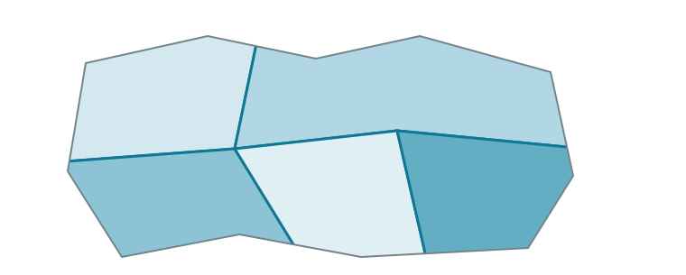
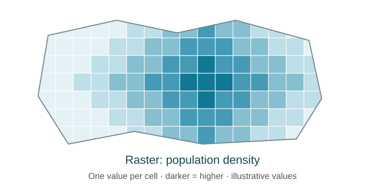

## Novel data as a contribution

| Paper | Data purpose | Data novelty |
|---|---|---|
| [D'Amico, Soltas, and Wang ('26)](https://evansoltas.com/papers/Durations_DSW2026.pdf) | Opportunity costs of permitting | US coverage from cities' websites + FOIA requests |
| [Walker and Wooders ('01)](https://www.aeaweb.org/articles?id=10.1257/aer.91.5.1521) | Nash Eq. in tennis | Handcoded match videos |
| [Carlson, Correia, and Luck ('22)](https://doi.org/10.1086/717453) | Banking competition and stability | OCR of archived 19th c. bank reports |
| [Cavallo and Rigobon ('16)](https://www.aeaweb.org/articles?id=10.1257/jep.30.2.151) | Daily prices and inflation | Scraped retailer websites  |
| [Baker, Bloom, and Davis ('16)](https://doi.org/10.1093/qje/qjw024) | Economic policy uncertainty | Word counts in newspaper text |
| [Henderson, Storeygard, and Weil ('12)](https://doi.org/10.1257/aer.102.2.994) | Economic growth in developing world | Satellite images of night lights |

## Cheaper collection makes ambitious data feasible

- You exercise judgement in identifying nonobvious data sources
- Agents write scrapers, parsers, and API clients in minutes

## Linking existing sources can create a new dataset

- Crosswalks: geographic codes, industry codes, identifiers that change over time
- Fuzzy matching: firm, lender, or school names across sources
- Example: [Feigenbaum ('18)](https://academic.oup.com/ej/article-abstract/128/612/F446/5089529) matches names in Iowa State Census of 1915 and 1940 Federal Census to estimate intergenerational mobility

## Agenda {.agenda}

1. Ways to obtain data
2. Types of data
3. Efficient tabular data management

## Ways to obtain data {.section-open}

- Use the most structured route that exists
- Less structured routes produce data that others do not have

## Data extraction methods

| Route | Example | Main risk |
|---|---|---|
| Download | Census, BLS, and IPUMS files | Unrecorded version changes |
| API | SEC EDGAR, Census API | Keys and rate limits |
| Web scraping | Public websites | Blocked requests, terms of use |
| Public-records request | Government files | Delay, denial, fees |
| Archives | Scanned reports, historical newspapers | OCR errors |

## General best practices

- When possible, extract raw data through a script
- Test the script on a subset of the data
- Always store unedited raw data
- In either case, record the URL, access date, and version next to the data

## API best practices

- **Security**: Read API keys from environment variables (if using a `.env` file, Git-ignore it), never hard-code them in a tracked script
- **Rate-limiting**: Check the API's limits beforehand and build in sleep times accordingly
- **Size**: Query only the rows and columns you need, and stream if the file would be out-of-memory

## Web scraping best practices

- **Check for alternatives**: Look for an API or a bulk download first
- **Transparency**: Identify yourself in a User-Agent header
- **Access rules**: Read the terms of use and `robots.txt`
- **Rate-limiting**: Implement delays between requests to avoid mimicking a Denial-of-Service (DoS) attack
- **Detect rendering**: Target static HTML code, or hidden APIs behind JavaScript-rendered sites

## Public-record request best practices

- Check if data are vended publicly (e.g., [NYC Open Data](https://www.nyc.gov/opendata))
- Check for existing requests (e.g., [MuckRock](https://www.muckrock.com/), [Data Liberation Project](https://www.data-liberation-project.org/))
- Initial response deadlines: generally 20 business days for [federal](https://www.foia.gov/foia-statute.html), 10 business days for [MA](https://www.sec.state.ma.us/divisions/public-records/public-records-law/public-records-request.htm). Delivery can take longer.
- Ask for an existing database export in an electronic format
- Be specific: fields, years, and record system


## Archives best practices

- Check for a digitized version: Search library and institutional repositories before scanning yourself
   - [HathiTrust](https://www.hathitrust.org/)
   - [Internet Archive](https://archive.org/)
   - [Chronicling America](https://chroniclingamerica.loc.gov/)
- Optical character recognition (OCR) quality: Prefer sources with a text layer rather than image-only scans

## Types of data {.section-open}

- Your final analysis will be tabular: columns of variables and rows of observations
- But there are many ways to get there!
- Six nonstandard examples: JSON, spatial data, networks, text, PDF scans, images/video/audio

## Tabular data is the target format

```text
county     year  state  unemp_rate  min_wage
Suffolk    2024  MA     4.1         15.00
Cheshire   2024  NH     2.6          7.25
```

- Some column or combination of columns should uniquely identify observations ("primary key")
- String categories can be converted to numeric as a set of dummy variables ("one-hot encoding")

## Example 1: JSON

- JSON is a common output format of APIs
- Efficiently stores nested relationships

Raw JSON:
```json
{"cik": "0000320193", "name": "Apple Inc.", "sic": "3571",
 "filings": [{"form": "10-Q", "filingDate": "2026-07-31"},
             {"form": "10-Q", "filingDate": "2026-05-01"}]}
```

Target tables:

| Table | One row per | Key |
|---|---|---|
| `firms` | Firm | `cik` |
| `filings` | Filing | `cik` and filing number |

## Example 2: Spatial

- Put all layers in the same coordinate reference system before a join

| Format | Represents |
|---|---|
| Vector points | Point locations |
| Vector polygons | Generic areas |
| Raster | Grid of squares |

```{=html}
<div class="r-stack spatial-examples">



</div>
```

::: {.notes}
Advance twice to replace points with polygons, then polygons with a raster.
All three diagrams depict the same invented region. Points could locate bank
branches, polygons could delineate counties, and raster cells could measure
population density. These are illustrations, not observed data.
:::


## Example 3: Networks

- Networks become a node table and an edge table

```text
nodes:  firm_id  industry         edges:  supplier  customer  year  sales
        F01      auto                     F07       F01       2004  ...
        F07      parts                    F09       F01       2004  ...
```

- Examples: friend connections, supply chains, financial intermediaries
- Survey: [Graham (2020), "Network Data," *Handbook of Econometrics*](https://bryangraham.github.io/econometrics/downloads/publications/HandbookOfEconometrics_7A_2020/NetworkDataPublished.pdf)


## Example 4: Text

```text
doc_id  firm  year  paragraph                          tariff_risk
0412    DE    2025  "Changes in trade policy could..."  1
0413    DE    2025  "Our dealers depend on credit..."   0
```

- Measure with keyword counts, a trained classifier, topics, or a language model
- Non-LLM resource: [Gentzkow, Kelly, and Taddy (2019), "Text as Data"](https://www.aeaweb.org/articles?id=10.1257/jel.20181020)
- LLM resource: [Expected Parrot](https://docs.expectedparrot.com/en/latest)

## Example 5: PDF scans

- If it has a text layer:
    - [pdfplumber](https://github.com/jsvine/pdfplumber) for text and tables
    - [Camelot](https://github.com/camelot-dev/camelot) for tables
- If not:
   - [Marker](https://api.datalab.to/blog/marker-2) for open-source, CPU/GPU-compatible OCR
   - [Docling](https://github.com/docling-project/docling) + [Tesseract](https://github.com/tesseract-ocr/tesseract) for OCR on CPU
- Compare multimodal AI models and OCR tools on [OCR leaderboards](https://huggingface.co/collections/davanstrien/ocr-leaderboards)

## Example 6: Images, Audio, or Video

- Multimodal LLMs can transform images, audio, or video (and, of course, text!) to structured numeric output
    - Image example: [Ludwig and Mullainathan '24](https://academic.oup.com/qje/article-abstract/139/2/751/7515309?redirectedFrom=fulltext) on mugshots predicting judge decisions
    - Audio example: [Gorodnichenko et al '23](https://www.aeaweb.org/articles?id=10.1257/aer.20220129) on emotion in Federal Reserve chair speech
    - Video example: [Dietrich '21](https://brycejdietrich.com/files/papers/Dietrich_cspan.pdf) on politicians literally crossing the aisle on C-SPAN
- Using a frontier model through an API generally incurs usage costs
- Open-weight models can run locally (e.g., through Ollama) or on a GPU cluster, depending on size
- In any case, validate a random sample with human annotation or source-of-truth measurements ([Dell and Rambachan '26](https://arxiv.org/html/2608.23524v1))

## Efficient tabular data management {.section-open}

- Script the workflow and save definitions and checks
- Store large tables in Parquet, keep datasets out of Git
- Keep local data backed up to Dropbox
- Use DuckDB to select, summarize, and join before loading results


## Script the workflow once and reuse results

**Raw downloads → comparable records → county-year counts → tables and figures**

- Keep downloads unchanged, with source URLs, dates, and versions
- Script cleaning, joins, and descriptive statistics


## Record lessons learned for yourself and agents

- **Schema**: codebook with meanings, types, units, codes, and year coverage
- **Decisions**: sample rules, recodes, and crosswalks in project files
- **Verification**: test an appropriate random sample, check counts/keys/missingness
- **Exploration**: distributions, trends, and correlations; figures for you and CSVs for agents


## Opinionated efficient tabular data storage: Parquet files

- [Apache Parquet](https://parquet.apache.org/docs/overview/) is a highly compressible columnar file type for tables
- Tradeoff is that there is no simple spreadsheet double-click inspection
    - Can inspect raw data in an interactive session when loaded locally, or export extract to a CSV

| [Mortgage data](https://paulgp.substack.com/p/large-datasets-and-structured-databases) | CSV | Parquet | Smaller by |
|---|---:|---:|---:|
| 2007–2024 | 70 GB | 6 GB | About 12× |


## Keep large datasets local and backed up

- **Never commit large datasets to Git**, including derived tables
- Add data paths to `.gitignore` before the first download
- Keep source data available locally and backed up in the cloud
- Commit scripts, codebooks, and small crosswalks

Example `.gitignore`:

```text
/data/raw/
/data/clean/
*.parquet
```


## Opinionated efficient tabular data I/O: DuckDB {.duckdb-benefits}

[DuckDB](https://duckdb.org/) is a local database engine based on SQL syntax

- **Flexible**: query Parquet, CSV, and JSON files directly
- **Selective**: return only the needed rows, columns, aggregates, or joined results
- **Out-of-memory capabilities**: can use temporary disk space when data exceed RAM
- **Fast**: optimized for filtering, grouped summaries, and joins

: 100 million rows, 5 GB, five grouped summaries

| DuckDB | Python pandas |
|---:|---:|
| 2 seconds | 42 seconds |


## Using DuckDB {.duckdb-workflow}

Multiple ways to apply the same SQL logic for extracting relevant data

```sql
SELECT county, year, COUNT(*) AS originations
FROM 'data/derived/hmda/*.parquet'
WHERE action = 1
GROUP BY county, year;
```

| Interface | Run the saved query | Purpose |
|---|---|---|
| **Python package** | `duckdb.sql(query).df()` | Reproducible scripting |
| **R package through DBI** | `dbGetQuery(con, query)` | Reproducible scripting |
| Command-line interface (CLI) | Start `duckdb`, enter SQL | Native terminal experience | 
| Local browser UI | Start `duckdb -ui` | Interactive exploration |

## Summary: from novel sources to usable data {.takeaways}

- **Find a contribution**: new sources, measurements, or links can create valuable data
- **Collect systematically**: use the most structured route available and preserve raw files
- **Enable reproducibility**: script transformations, save definitions, and explore and check results
- **Handle big data**: Store in Parquet, query with DuckDB, and back up outside Git

## Exercise: Discuss potential nonstandard data sources

- Split into groups of 2
- Each student presents one of their "ambitious" data sources
- The other student provides thoughts on how to make it feasible


## For Monday October 5: Lightning Project Proposal

- Each student will have 5 minutes to present a single slide on their proposed project
- Highlight research question, proposed strategy to answer it, and why it matters
- Advice:
    - Avoid overloading the slide with text
    - Practice a timed presentation several times
